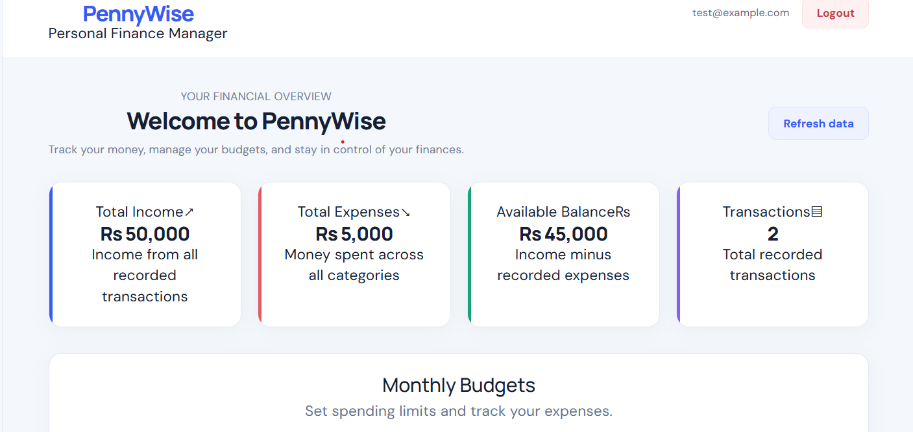
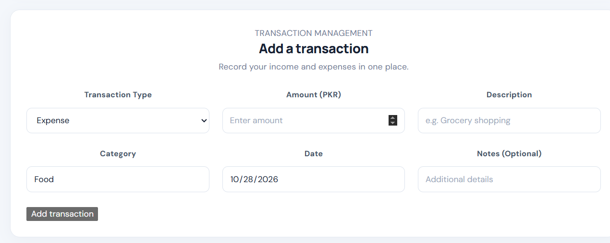
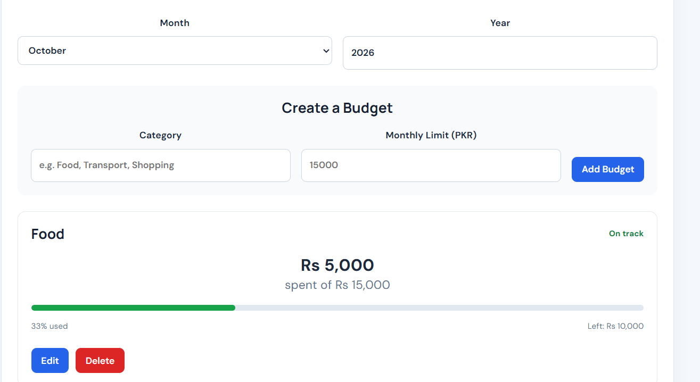
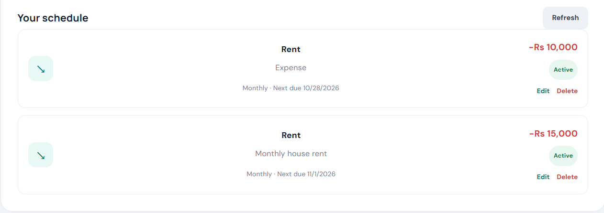

# PennyWise — Personal Finance Manager

PennyWise is a full-stack personal finance management application built with React and ASP.NET Core Web API. It helps users manage income and expenses, track budgets, and organize recurring transactions.

## Features

- User registration and login with JWT authentication
- Add, view, edit, and delete income and expense transactions
- Dashboard with financial summaries and charts
- Search and filter transactions
- Monthly budgets with spending progress
- Recurring transaction schedules with pause and resume controls
- SQLite database with Entity Framework Core

## Tech Stack

- **Frontend:** React
- **Backend:** ASP.NET Core Web API (.NET)
- **Database:** SQLite
- **ORM:** Entity Framework Core
- **Authentication:** JWT

## Screenshots

### Dashboard

### Transaction Management

### Budget Management

### Recurring Transactions

### Category Analysis

### Financial Insights

### Recurring Schedule

## Running the Project

The frontend and backend have separate setup requirements. See the frontend and API project folders for their respective configuration.

## Author

Ahmad Waseem
